<picture><source media="(prefers-color-scheme: dark)" srcset="assets/hero-dark.svg" />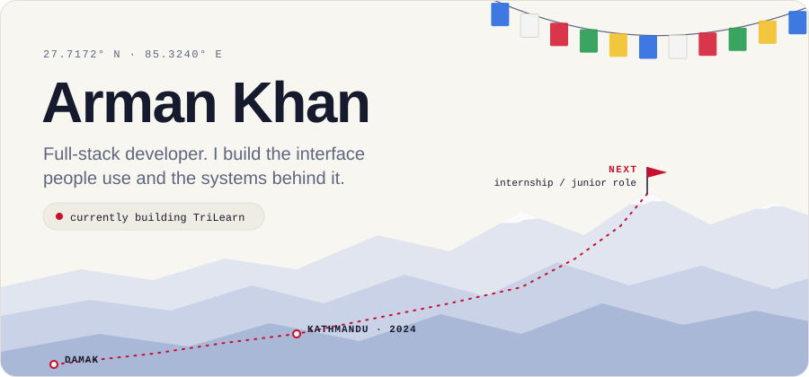</picture>

<a href="https://armankhan.com.np"><picture><source media="(prefers-color-scheme: dark)" srcset="assets/btn-portfolio-dark.svg" />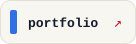</picture></a>
<a href="https://www.linkedin.com/in/techiee-arman"><picture><source media="(prefers-color-scheme: dark)" srcset="assets/btn-linkedin-dark.svg" />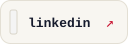</picture></a>
<a href="https://www.instagram.com/techiee.arman"><picture><source media="(prefers-color-scheme: dark)" srcset="assets/btn-instagram-dark.svg" />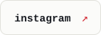</picture></a>
<a href="https://www.facebook.com/techiee.arman"><picture><source media="(prefers-color-scheme: dark)" srcset="assets/btn-facebook-dark.svg" /></picture></a>

From Damak, Jhapa to Kathmandu, studying IT. The part I care about most is the part nobody sees: logins, data, and APIs that still hold up when the input is wrong.

 

<picture><source media="(prefers-color-scheme: dark)" srcset="assets/work-head-dark.svg" />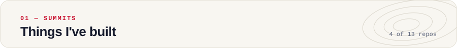</picture>
<a href="https://github.com/armancore/TriLearn"><picture><source media="(prefers-color-scheme: dark)" srcset="assets/work-trilearn-dark.svg" /></picture></a>
<a href="https://github.com/armancore/bus_ticket"><picture><source media="(prefers-color-scheme: dark)" srcset="assets/work-sajilo-bus-ticket-dark.svg" /></picture></a>
<a href="https://github.com/armancore/Nepal-Patra"><picture><source media="(prefers-color-scheme: dark)" srcset="assets/work-nepal-patra-dark.svg" />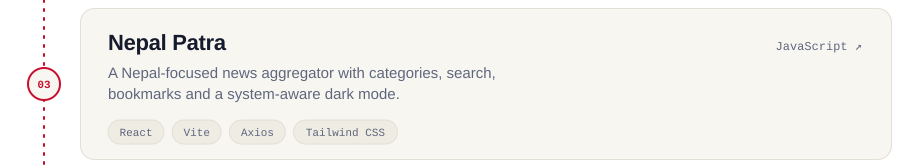</picture></a>
<a href="https://github.com/armancore/VibeTyper"><picture><source media="(prefers-color-scheme: dark)" srcset="assets/work-vibetyper-dark.svg" />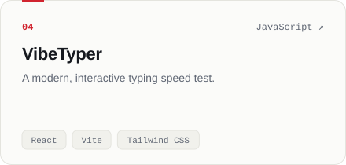</picture></a>

Also on the trail: [CineVault](https://github.com/armancore/movie-app) · [Expense Tracker](https://github.com/armancore/expense-tracker) · [portfolio](https://github.com/armancore/portfolio) · [all repos →](https://github.com/armancore?tab=repositories)

 

<picture><source media="(prefers-color-scheme: dark)" srcset="assets/stack-dark.svg" /></picture>

 

<picture><source media="(prefers-color-scheme: dark)" srcset="assets/trail-head-dark.svg" />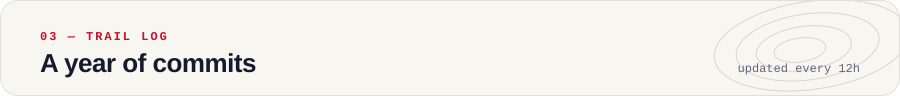</picture>
<picture><source media="(prefers-color-scheme: dark)" srcset="https://raw.githubusercontent.com/armancore/armancore/output/github-snake-dark.svg" /></picture>

  

<a href="https://armankhan.com.np"><picture><source media="(prefers-color-scheme: dark)" srcset="assets/footer-dark.svg" /></picture></a>
